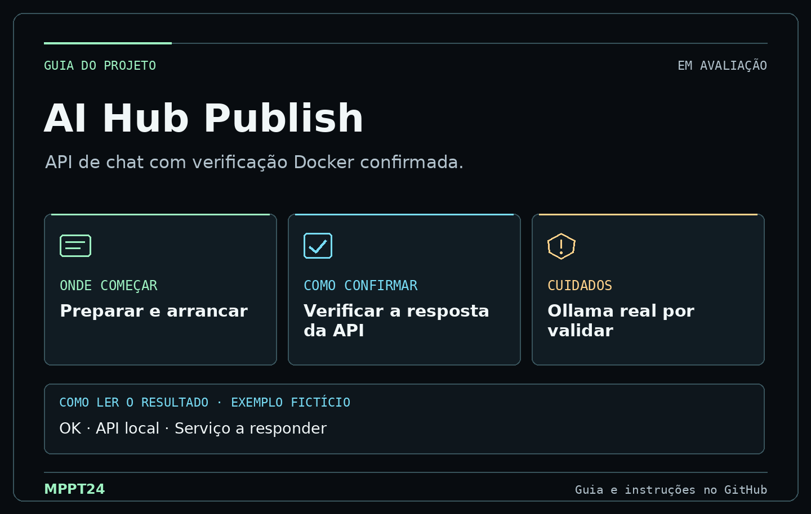

# Guia de AI Hub Publish

**Estado:** Em avaliação.

API de chat com verificação Docker confirmada.

[](docs/guia-visual.png)

## Onde começar

Segue [Testar a API localmente](README.md#testar-a-api-localmente).

## Como confirmar

`bash scripts/test_request.sh` deve devolver um JSON com `"ok": true`. Este teste confirma a API mesmo sem Ollama.

## Como ler os registos

`docker compose logs agent-hub` mostra o arranque. Se a saúde passar e o chat falhar, revê o endereço do Ollama e o nome do modelo. Em **Actions**, os testes do contentor aparecem separados.

### Exemplo fictício

```text
OK · API local · Serviço a responder
```

Neste exemplo, «Serviço a responder» significa que o teste conseguiu falar com a API. Se o chat falhar depois, consulta os registos do Hub e confirma a configuração do modelo. [Ver a verificação em Docker no GitHub](https://github.com/mppt24/ai-hub-publish/actions/runs/44919982694)

## Cuidados

O protótipo ainda não tem autenticação própria. Mantém o percurso de teste local e não partilhes o ficheiro `.env`. A conversa com Ollama real ainda não foi validada nesta revisão.
